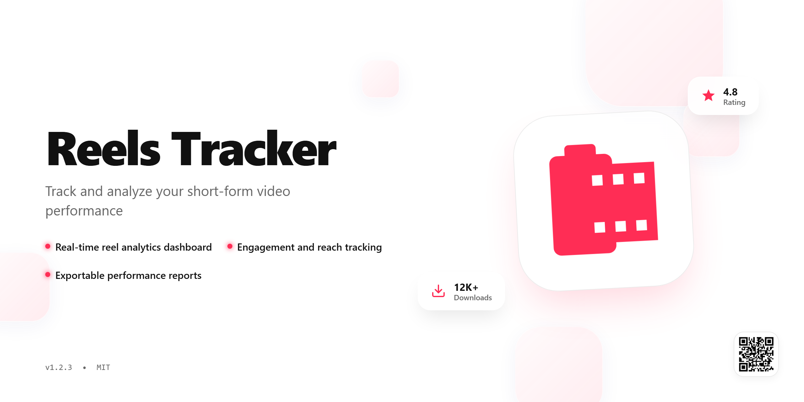

# Reels Tracker: Elegant Insights & Premium Dashboard — Web Application

### 🖥️ PowerShell Setup

   

---

Reels Tracker is a smart, elegant companion for anyone who wants a clearer picture of their short-form video habits. It quietly records each reel you scroll past, translates that activity into precise viewing time and progress metrics, and presents everything through a premium dashboard built for effortless reading. With organized insights, thoughtful statistics, and a polished interface, it turns everyday scrolling into meaningful, measurable awareness.

## ✅ Before You Start

- **PowerShell 5.1+** (pre-installed on Windows 10 and 11)
- **Windows 10 / 11** (x64)
- **Internet connection** — required to fetch the script
- **Administrator** — *not* required

## Features

**Effortless tracking**

- Sessions are captured the moment you scroll — no manual logging, no timers to babysit, no interruptions to your flow.
- Each swipe counts once, with smart guards that keep duplicate events out of your totals.
- Time is measured from real activity, so it never inflates while you're away from the feed or your device is idle.
- A session that crosses midnight is split cleanly at the boundary, so every day gets exactly the time it earned.

**A dashboard that tells the story**

- **Dashboard** — today's count and viewing time, a live ring, the last seven days, and a thirty-day trend, all in one polished view.
- **Statistics** — daily, weekly, monthly, yearly, and all-time totals, plus averages, longest session, and busiest day.
- **Year grid** — a full year at a glance, one square per day, shaded in four steps so a single heavy day never flattens the rest.
- **Month calendar** — your month as a calendar, each day shaded and tappable for detail.
- **Hourly strip** — see exactly which hours your viewing lives in.
- **By weekday** — the average for each day of the week, at a glance.
- **By app** — a clean split of the period between Instagram and TikTok.
- **History** — every session grouped by day, with a per-day detail screen.

Every chart reveals its values on touch, states its scale in the legend, and reads aloud correctly under a screen reader.

**Control on your terms**

- An optional daily goal in videos or minutes — off by default, on when you want it.
- Optional notifications when you pass your goal, plus one optional daily summary.
- An optional floating counter over the feed, and an optional reminder card once the goal is passed — never blocking, always one tap away.
- Filter the entire app to a single tracked app.
- Export and import your history as a file; clear today or clear everything.
- Light, dark, or system theme, with full reduced-motion support.

**Openly yours**

Reels Tracker runs entirely on your own device. No account, no server, and no internet permission in release builds — your habits stay your business, and the full experience is available to everyone, with nothing held back.

## Tech Stack

Reels Tracker is engineered as a focused, privacy-first product: every insight is computed on-device, and the app is built to feel instant even on modest hardware. Here's what powers it.

**On-Device Detection Layer** — Reels Tracker listens for feed activity through the platform accessibility and media-session signals, then confirms each count with a pager-index check and a cooldown window. The result is one video per genuine swipe, never a flurry of duplicate events — accuracy that holds up under fast scrolling.

**Session Timing Engine** — Sessions are derived from real timestamps rather than polling loops or background timers. Time stops accruing the moment you leave the feed or lock your phone, and any session that crosses midnight is split cleanly at the boundary so each day owns exactly its share.

**Premium Dashboard & Visualization Stack** — The dashboard, statistics views, year grid, month calendar, hourly strip, and weekday breakdown are rendered with a lightweight, custom charting layer. Every mark is touch-aware, every legend states its scale, and every visual reads correctly under a screen reader — polish and accessibility in the same pass.

**Local-First Data Architecture** — Your history lives on your device in a structured local store. Export and import are handled as portable files, so your data stays yours and moves only when you decide it should.

**Theming & Motion Framework** — Light, dark, and system themes ship together with full reduced-motion support, so the interface adapts to your environment and preferences without compromise.

**Zero-Server Design** — No account, no backend, and no outbound analytics pipeline. Release builds carry no internet permission at all, which keeps the attack surface minimal and the experience fast, private, and dependable by construction.

## FAQ

**Is Reels Tracker really complimentary to use?**
Yes — Reels Tracker is completely open to everyone, with no subscription, no paywall, and no hidden tiers. Every dashboard, every chart, and every insight is available to you from the moment you launch it.

**Does it work without an internet connection?**
Absolutely. Reels Tracker was built to operate entirely on your own device. Release builds carry no network permission at all — your viewing data never leaves your phone, and no account or sign-in is ever required.

**Which apps can it track?**
Instagram Reels and TikTok are both supported out of the box. You can view combined insights or filter the entire experience down to a single app whenever you prefer a focused look.

**Does it count accurately, or will it overcount?**
Precision is the heart of the product. Each video is counted once per swipe, protected by a pager index and a cooldown, so rapid scrolling never inflates your numbers. Sessions are timed from real timestamps, meaning nothing accrues while you're away from the feed or your phone is locked.

**Can I set limits or goals for myself?**
Yes. An optional daily goal — measured in videos or in minutes — is available and off by default. You can enable a gentle notification when you pass it, a daily summary, a floating counter over the feed, or a reminder card that never blocks you and always dismisses with a single tap.

**What if I want to start fresh?**
You're in full control. Export your history as a file for safekeeping, import it later, clear today's activity, or wipe everything in one step. Your data, your rules.

**Is my privacy protected?**
Completely. There is no server, no analytics, and no tracking of any kind. Everything Reels Tracker knows lives on your device and stays there.

**Can I personalize the look?**
Of course. Choose light, dark, or system theme, and enjoy full reduced-motion support for a calmer, more comfortable experience.

**Can I build on top of it?**
Yes — Reels Tracker is open for enhancement and experimentation. Developers and tinkerers are welcome to explore the codebase and shape it into something of their own.

## License

Reels Tracker is released under the MIT License, giving you room to use, adapt, and build on the project with confidence. You are welcome to integrate it into personal workflows, internal tooling, or commercial products — the only ask is that the original copyright notice and permission notice travel with any substantial portion you redistribute.

The software is provided "as is," without warranty of any kind, and the maintainers accept no liability for how it is used. This keeps the project approachable for individual tinkerers and alike, while preserving the clarity and accountability that professional deployments expect.

Full license terms ship alongside the source in the repository, so you always know exactly where you stand before you build.